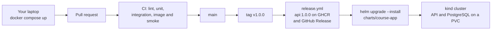

# Capstone · Ship it, run it, explain it

## Run it from zero

From a fresh clone to a working app on your laptop.

### 1. Local: Compose

```bash
git clone https://github.com/ikaran34/turiba-devops-labs.git
cd turiba-devops-labs
cp .env.example .env
# Edit .env, set DB_PASSWORD to any password you like
docker compose up -d
# Open http://localhost:8081 — add a todo, it works.
```

### 2. Cluster: kind + Helm

```bash
kind create cluster --name capstone

kubectl create namespace course
kubectl create secret generic db-secret \
  --namespace course \
  --from-literal=password=REPLACE_WITH_YOUR_PASSWORD

helm upgrade --install course-app charts/course-app -n course

kubectl get pods -n course
kubectl port-forward -n course svc/api 5000:80 &
curl http://localhost:5000/api/todos

kind delete cluster --name capstone
```

## Architecture



A commit on a branch becomes a pull request. CI runs four jobs: lint, unit, integration with a real Postgres, and image with a smoke test. Merging to `main` pushes the image to GHCR. Tagging `v1.0.0` runs `release.yml`, which builds for amd64 and arm64, pushes to GHCR, and creates a GitHub Release. On a kind cluster, `helm upgrade --install` deploys the chart: the API at three replicas and PostgreSQL on a PVC.

## What is where

| Path | What it is |
|---|---|
| `api/Dockerfile` | Multi-stage Node build, non-root user, HEALTHCHECK |
| `api/server.js` | Express API with `/healthz` at line 24 |
| `compose.yaml` | Local dev: db, api, web |
| `.github/workflows/ci.yml` | lint, unit, integration, image jobs |
| `.github/workflows/release.yml` | Tag-triggered release to GHCR and GitHub Release |
| `charts/course-app/` | Helm chart (API + DB + PVC + ConfigMap) |
| `infra/` | OpenTofu: kind cluster + Helm release |
| `web/` | nginx front end (Compose only) |

## Level and evidence

I am claiming **Target**.

- **M1 — Containers and local dev.** `api/Dockerfile` is multi-stage and runs as `USER node`. `docker compose up -d` starts db, api, web; the todo app works at `http://localhost:8081`.
- **M2 — Version control.** `main` is protected with all four checks required. Every change landed through a PR. Commit messages follow Conventional Commits.
- **M3 — CI.** `.github/workflows/ci.yml` runs `lint`, `unit`, `integration` (real Postgres 17 service), and `image` (build + smoke test + push on main only). All four are required checks.
- **M4 — Release 1.0.0.** Tag `v1.0.0` created by `github-actions[bot]`. Image at `ghcr.io/ikaran34/turiba-devops-labs/api:1.0.0` (public, amd64 + arm64). GitHub Release `v1.0.0` with generated notes.
- **M5 — Kubernetes with Helm.** `helm install course-app charts/course-app -n course` gives 3 API pods + 1 DB pod. Image tag is `1.0.0`, not `latest`. Readiness and liveness probes, resource requests/limits, ConfigMap for settings, DB password in a Secret outside Git, PostgreSQL on a PVC that survives deleting the DB pod. `helm upgrade` and `helm rollback` both work.
- **M6 — No secrets in Git.** `.gitignore` covers `.env`, `.env.*`, `*.tfstate`, `*.old`, `backup/`. `.env.example` documents the shape.
- **M7 — This README.**

### Target items

- **T1 — Infrastructure as code.** `infra/` holds OpenTofu for kind + Helm. `tofu apply` creates the cluster and installs the chart. `tofu destroy` tears it down. Running `tofu apply` again rebuilds everything from scratch. State files are not committed (verified with `.gitignore`).

## When it breaks

For the app on the cluster, three likely faults and how to find each one:

1. **API pod in CrashLoopBackOff.** `kubectl logs -n course deploy/course-app-api` — usually the DB password is wrong or Postgres is not yet ready.
2. **API returns 500 with the DB running.** `kubectl exec -n course deploy/course-app-api -- env | grep DB_` — the Secret is mounted but the env var names do not match what `api/db.js` reads.
3. **DB pod Pending, PVC not bound.** `kubectl describe pvc -n course` — the StorageClass may be missing. `kubectl get sc` should show `standard` on kind.

## Known issues

- Resource requests and limits are not set on every container in the chart.
- `infra/` OpenTofu code was applied locally but a full `tofu destroy` then `tofu apply` cycle has not been re-tested.
- `web` runs only in Compose, not on the cluster (allowed by the brief).

## AI use

Used Claude (Anthropic) to help with Mermaid diagram syntax, debugging a heredoc issue in the capstone README, and organizing the README sections against the capstone brief. All code review and file edits are my own.
