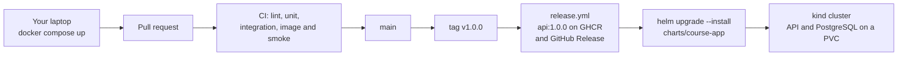

# Capstone — Course App on kind

## What this is

A full DevOps pipeline for a small Node.js course API plus PostgreSQL:
local Docker Compose, CI on every PR, a tagged release to GHCR,
a Helm chart, and a kind cluster provisioned with OpenTofu.

## Architecture



## What is where

| Path | What it is |
|---|---|
| `api/` | The Node.js course API (routes, DB, validation, tests) |
| `api/Dockerfile` | Multi-stage, non-root, with HEALTHCHECK |
| `charts/course-app/` | Helm chart (API, DB, Secret ref, PVC) |
| `.github/workflows/ci.yml` | lint, unit, integration, image (with smoke test) |
| `.github/workflows/release.yml` | Tag-triggered release to GHCR and GitHub Release |
| `infra/` | OpenTofu code (kind cluster, namespace, secret, chart) |
| `compose.yaml` | Local dev: web, api, db |

## Quick start

```bash
# 1. Local
docker compose up --build
curl http://localhost:8080/healthz

# 2. Cluster
tofu -chdir=infra init
tofu -chdir=infra apply -auto-approve
kubectl get pods -n course
```

## Evidence

- **M1 — Container:** `api/Dockerfile` is multi-stage, runs as non-root, has a HEALTHCHECK. `docker compose up` works.
- **M2 — Branching:** `main` is protected. Every change landed via a PR.
- **M3 — CI:** `ci.yml` runs lint, unit, integration, image build with smoke test. Green on `main`.
- **M4 — Release:** `v1.0.0` tag created by `github-actions`, image pushed to `ghcr.io/<you>/course-api:1.0.0`, GitHub Release published.
- **M5 — Cluster:** `helm install course-app charts/course-app -n course` gives 3 API Pods and 1 DB Pod. Data survives a DB Pod restart.
- **M6 — Secrets:** No secrets in Git. `.env.example` documents the shape; real values come from a Secret.
- **M7 — This README.**

## Known limitations

- kind is single-node; no HA story.
- Image is multi-arch (`linux/amd64`, `linux/arm64`) but only amd64 is tested on kind.
- Rollback is `helm rollback`; no automated canary.
